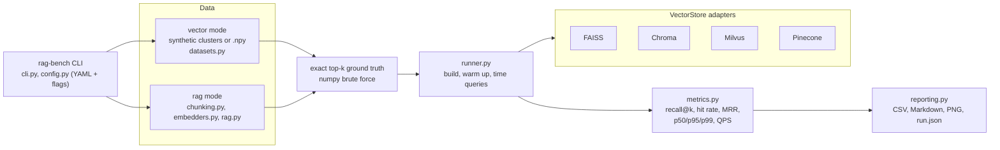
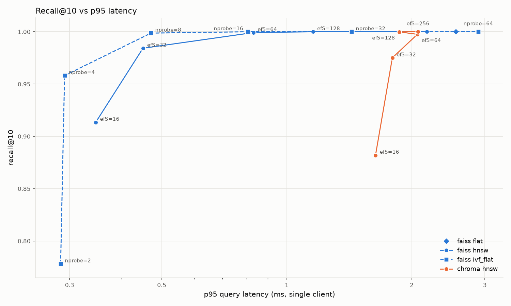

# rag-benchmark

[](https://github.com/jasbir101/rag-benchmark/actions/workflows/ci.yml)


Picking a vector store for retrieval-augmented generation usually comes down to
blog-post numbers measured on someone else's data and hardware. **rag-benchmark**
measures them on yours: it puts FAISS, Chroma, Milvus and Pinecone behind one small
adapter interface and reports, per backend and index configuration, **recall@k
against exact brute-force ground truth**, **p50/p95/p99 query latency**,
**throughput** and **index build time**. A second mode runs the same backends over
a real text corpus and question set and adds **hit rate@k** and **MRR**, so you can
also compare chunking strategies and embedding models. Everything in vector mode
runs offline on a laptop; the hosted backends switch on only when you configure
them.

## Features

- **One adapter interface** (`VectorStore`: `build`, `search`, `close`) for
  FAISS (Flat, HNSW, IVF-Flat), Chroma (in-memory, HNSW), Milvus / Zilliz Cloud and
  Pinecone serverless.
- **Exact ground truth** computed once per dataset with numpy, with a float64
  re-rank and **tie-aware recall** so equally-near neighbours are not counted as misses.
- **Latency the way a single client sees it** (one query per call, p50/p95/p99) plus
  **batch throughput** (all queries in one call).
- **Parameter sweeps** from YAML: `ef_search: [16, 32, 64]` expands into three configs.
- **Vector mode**: deterministic synthetic clustered embeddings (n, dim, clusters,
  seed) or your own vectors from a `.npy` file.
- **RAG mode**: `.txt`/`.md` corpus + JSONL questions, fixed-size and recursive
  (paragraph -> sentence -> word) chunkers, and three embedders: an offline hashing
  baseline, sentence-transformers, or Google Gemini (`google-genai`).
- **Reports**: CSV, a Markdown table, a recall-vs-p95-latency chart and a `run.json`
  that records CPU, RAM, OS and library versions with every run.
- **Optional backends skip cleanly** with a one-line reason when their SDK or
  credentials are missing; the base install stays light.

## Architecture



## Quickstart

Requires Python 3.12 or 3.13.

```powershell
# Windows (PowerShell)
git clone https://github.com/jasbir101/rag-benchmark.git
cd rag-benchmark
py -3.13 -m venv .venv
.venv\Scripts\Activate.ps1
python -m pip install -e ".[dev]"
```

```bash
# Linux / macOS
git clone https://github.com/jasbir101/rag-benchmark.git
cd rag-benchmark
python3 -m venv .venv
source .venv/bin/activate
python -m pip install -e ".[dev]"
```

Then:

```bash
rag-bench backends                                   # what can run here, and why not
rag-bench vector --n 20000 --dim 384 --k 10 --backends faiss,chroma
```

Results land in `results/<mode>-<timestamp>/`.

Optional extras:

| Extra | Installs | Enables |
|---|---|---|
| `milvus` | `pymilvus` | the Milvus / Zilliz Cloud backend |
| `pinecone` | `pinecone` | the Pinecone backend |
| `local-embed` | `sentence-transformers` | `--embedder local` in rag mode |
| `dev` | `pytest`, `ruff` | tests and linting |

```bash
python -m pip install -e ".[milvus,pinecone,local-embed]"
```

## CLI examples

```bash
# Synthetic vectors, default sweeps for every backend that can run
rag-bench vector

# The exact configuration behind the results below
rag-bench vector --config configs/vector-20k.yaml

# Larger dataset, FAISS only, L2 distance
rag-bench vector --n 100000 --dim 768 --metric l2 --backends faiss

# Your own embeddings: 1,000 rows are held out as queries
rag-bench vector --npy my_embeddings.npy --queries 1000

# RAG mode on the bundled toy corpus with the offline hashing embedder
rag-bench rag --corpus data/sample/corpus --questions data/sample/questions.jsonl \
    --embedder hash --k 3 --chunk-size 400 --chunk-overlap 50 --backends faiss,chroma

# Same, from YAML, with Gemini or a local sentence-transformers model
rag-bench rag --config configs/rag-sample.yaml --embedder gemini
rag-bench rag --config configs/rag-sample.yaml --embedder local \
    --embed-model sentence-transformers/all-MiniLM-L6-v2
```

Run `rag-bench vector -h` / `rag-bench rag -h` for every flag.

## Configuration

Settings resolve as **built-in defaults < YAML file (`--config`) < CLI flags**. A YAML
file may use flat keys or `dataset:` / `rag:` sections, and an `indexes:` block
per backend where any list value becomes a sweep:

```yaml
k: 10
backends: [faiss, chroma, milvus, pinecone]
dataset: {n: 20000, dim: 384, clusters: 64, queries: 1000, seed: 42}
indexes:
  faiss:
    - {index: flat}
    - {index: hnsw, M: 32, ef_construction: 200, ef_search: [16, 32, 64, 128, 256]}
    - {index: ivf_flat, nlist: 256, nprobe: [2, 4, 8, 16, 32, 64]}
  chroma:
    - {M: 16, ef_construction: 100, ef_search: [16, 32, 64, 128, 256]}
```

Unknown keys are rejected, so a typo fails loudly instead of being ignored. For
FAISS IVF, `nlist: auto` (the built-in default) means `4 * sqrt(n)`, capped so every
list gets at least 39 training points; that keeps the default sweep valid on small
corpora. Without a YAML `indexes:` block each backend uses the sweeps in
`DEFAULT_INDEXES` (`src/rag_benchmark/config.py`).

### Environment variables

Copy `.env.example` to `.env` (it is gitignored) or export the variables. A `.env`
in the working directory is read on start-up and never overrides variables that are
already set. Empty values count as unset.

| Variable | Used by | Default | Notes |
|---|---|---|---|
| `GEMINI_API_KEY` | `--embedder gemini` | none | Required for Gemini embeddings. |
| `GEMINI_EMBED_MODEL` | `--embedder gemini` | `gemini-embedding-001` | Change here (or with `--embed-model`) when models are renamed. |
| `GEMINI_EMBED_DIM` | `--embedder gemini` | model default | Optional `output_dimensionality`; vectors are re-normalised. |
| `MILVUS_URI` | Milvus backend | none | Milvus server (`http://host:19530`) or Zilliz Cloud URI. Backend is skipped when unset. Milvus Lite (local file) does not run on Windows. |
| `MILVUS_TOKEN` | Milvus backend | empty | `user:password` or an API key. |
| `PINECONE_API_KEY` | Pinecone backend | none | Backend is skipped when unset. |
| `PINECONE_INDEX` | Pinecone backend | `rag-benchmark` | Created (serverless) if missing and deleted after the run only if this run created it. |
| `PINECONE_CLOUD` / `PINECONE_REGION` | Pinecone backend | `aws` / `us-east-1` | Where a new index is created. |

Milvus and Pinecone are hosted services: their latencies include the network round
trip from your machine, and Pinecone usage may count against your plan (a run
upserts `n` vectors into a temporary namespace and issues about `2 x queries` reads).

## Measured results

Measured on 19 October 2026 on a laptop:

- **CPU**: 13th Gen Intel Core i7-1355U (10 cores / 12 threads)
- **RAM**: 15.7 GB visible to the OS
- **OS**: Windows 11 Home, build 10.0.26300; Python 3.13.14
- **Libraries**: faiss-cpu 1.15.1, chromadb 1.5.9, numpy 2.5.4

Command: `rag-bench vector --config configs/vector-20k.yaml`. Data: 20,000 synthetic
384-d unit vectors in 64 Gaussian clusters (seed 42), 1,000 held-apart queries,
cosine similarity, k = 10, 50 warm-up queries per config. Full output, including
`run.json`, is in [`docs/results/vector-20k-384d/`](docs/results/vector-20k-384d/).

| Backend | Config | Build (s) | Recall@10 | p50 (ms) | p95 (ms) | p99 (ms) | QPS (1 client) | QPS (batch) |
|---|---|---:|---:|---:|---:|---:|---:|---:|
| faiss | flat | 0.03 | 1.0000 | 1.976 | 2.554 | 4.227 | 501 | 8,158 |
| faiss | hnsw M=32 efC=200 efS=16 | 3.79 | 0.9135 | 0.250 | 0.347 | 0.418 | 3,904 | 29,736 |
| faiss | hnsw M=32 efC=200 efS=32 | 3.48 | 0.9842 | 0.337 | 0.450 | 0.600 | 2,904 | 19,920 |
| faiss | hnsw M=32 efC=200 efS=64 | 3.68 | 0.9992 | 0.545 | 0.831 | 0.948 | 1,740 | 8,164 |
| faiss | hnsw M=32 efC=200 efS=128 | 3.79 | 1.0000 | 0.842 | 1.156 | 1.391 | 1,153 | 4,760 |
| faiss | hnsw M=32 efC=200 efS=256 | 3.58 | 1.0000 | 1.515 | 2.175 | 2.840 | 633 | 4,244 |
| faiss | ivf_flat nlist=256 nprobe=2 | 0.53 | 0.7782 | 0.169 | 0.285 | 0.390 | 5,433 | 45,496 |
| faiss | ivf_flat nlist=256 nprobe=4 | 0.54 | 0.9581 | 0.185 | 0.292 | 0.379 | 5,130 | 25,333 |
| faiss | ivf_flat nlist=256 nprobe=8 | 0.60 | 0.9987 | 0.290 | 0.471 | 0.700 | 3,239 | 10,513 |
| faiss | ivf_flat nlist=256 nprobe=16 | 0.69 | 1.0000 | 0.482 | 0.805 | 0.942 | 1,967 | 5,683 |
| faiss | ivf_flat nlist=256 nprobe=32 | 0.86 | 1.0000 | 1.030 | 1.433 | 1.643 | 957 | 5,569 |
| faiss | ivf_flat nlist=256 nprobe=64 | 0.69 | 1.0000 | 1.886 | 2.892 | 3.908 | 501 | 2,554 |
| chroma | M=16 efC=100 efS=16 | 4.38 | 0.8820 | 1.302 | 1.636 | 1.826 | 799 | 3,469 |
| chroma | M=16 efC=100 efS=32 | 4.25 | 0.9751 | 1.218 | 1.796 | 2.243 | 803 | 3,322 |
| chroma | M=16 efC=100 efS=64 | 3.95 | 0.9975 | 1.483 | 2.063 | 2.654 | 645 | 2,653 |
| chroma | M=16 efC=100 efS=128 | 5.09 | 0.9999 | 1.462 | 1.866 | 2.697 | 715 | 2,295 |
| chroma | M=16 efC=100 efS=256 | 3.83 | 1.0000 | 1.551 | 2.071 | 2.303 | 652 | 1,937 |

Milvus and Pinecone were **not run** for these results (no server or account was
configured); the run reported them as skipped.



What this run shows, and what it does not:

- On this data, the cheapest configs at recall@10 >= 0.99 were FAISS IVF-Flat
  `nprobe=8` (0.9987, p95 0.47 ms) and FAISS HNSW `efS=64` (0.9992, p95 0.83 ms).
  Chroma reached 0.9975 at `efS=64` with a p95 of 2.06 ms.
- Chroma's single-query latency stays between roughly 1.2 and 1.6 ms at p50 across
  the whole `ef_search` sweep, which suggests per-call overhead in its client/query
  path dominates at this size rather than the graph search itself. That is an
  inference from these numbers, not a profile.
- FAISS is an in-process library and Chroma is a database with an API layer, so
  this compares deployment shapes as much as index algorithms. The HNSW settings
  also differ (FAISS `M=32, efC=200`, Chroma `M=16, efC=100`), so build times are
  not like-for-like.
- **Noise**: in three back-to-back runs of this exact config on the same machine,
  FAISS recall was identical, Chroma recall moved by at most 0.006 (its multithreaded
  build is not deterministic), and the p95 of a given config varied by up to about
  40% between its fastest and slowest run (14 of the 17 configs stayed within 25%).
  The table is a single run; treat small latency gaps as ties.
- Synthetic Gaussian clusters are not real text embeddings. For a decision, rerun
  with `--npy` on embeddings of your own corpus.

### RAG mode on the bundled toy corpus

`rag-bench rag --config configs/rag-sample.yaml`: 10 short documents, 30 questions,
the offline **hashing** embedder (lexical, not semantic), chunk size 400 characters,
overlap 50, k = 3. Same machine as above; full output in
[`docs/results/rag-sample-hash/`](docs/results/rag-sample-hash/).

| Chunker | Chunks | Backend / config | Recall@3 | Hit@3 | MRR@3 |
|---|---:|---|---:|---:|---:|
| fixed | 51 | faiss flat | 1.0000 | 0.933 | 0.894 |
| fixed | 51 | faiss hnsw M=16 efC=100 efS=32 | 1.0000 | 0.933 | 0.894 |
| fixed | 51 | chroma M=16 efC=100 efS=32 | 1.0000 | 0.933 | 0.894 |
| recursive | 60 | faiss flat | 1.0000 | 1.000 | 0.944 |
| recursive | 60 | faiss hnsw M=16 efC=100 efS=32 | 1.0000 | 1.000 | 0.944 |
| recursive | 60 | chroma M=16 efC=100 efS=32 | 1.0000 | 1.000 | 0.944 |

With 51-60 vectors every index is effectively exact, so this exercises the pipeline
and the chunker comparison rather than the databases; the latencies in the full
report are not meaningful at this size. The Gemini and sentence-transformers
embedders were **not run** for this README (no API calls were made; both paths are
covered by mocked tests).

## How it measures

- **Ground truth**: exact top-k for every query by brute force in numpy. Scores are
  computed in float32, then the best `k + 16` candidates are re-scored in float64;
  ties are broken by the lower id.
- **Recall@k**: `|returned top-k  ∩  exact top-k| / k`, averaged over queries. A
  returned id outside the exact set still counts if its exact similarity equals the
  k-th true neighbour's (within 1e-6), so ties are not penalised.
- **Latency**: each query is sent alone, sequentially, and timed around the
  adapter's `search` call (so it includes client-side conversion). p50/p95/p99 are
  over all queries. **QPS (1 client)** is queries divided by the wall time of that loop.
- **QPS (batch)**: all queries in one `search` call. FAISS, Chroma and Milvus use
  their batch APIs (FAISS parallelises across cores); the Pinecone adapter loops.
- **Build time**: from empty to searchable. FAISS train + add; Chroma create
  collection + batched adds; Milvus insert + flush + create index + load; Pinecone
  upsert + wait until every vector is visible.
- **Warm-up**: `warmup` untimed queries per config, drawn from the base vectors so
  no cache sees the timed queries early.
- **Hit@k / MRR@k** (rag mode): the rank of the first retrieved chunk that belongs
  to the question's `answer_doc`.
- Every config builds its own index from scratch, even when only a query-time
  parameter changes, so each row has its own build time.

## Adding a backend

1. Create `src/rag_benchmark/adapters/<name>_backend.py` with a subclass of
   `VectorStore`:

   ```python
   class QdrantStore(VectorStore):
       name = "qdrant"

       @classmethod
       def unavailable_reason(cls) -> str | None:
           # Return why it cannot run (SDK missing, env var unset), or None.
           ...

       def build(self, vectors: np.ndarray) -> None:
           x = self._as_matrix(vectors)  # float32, right shape, normalised for cosine
           # Insert rows with ids 0..n-1 and make them searchable.
           ...

       def search(self, queries: np.ndarray, k: int) -> np.ndarray:
           # Return pad_ids(id_lists, k): int64, shape (n_queries, k), -1 padded.
           ...

       def close(self) -> None:
           # Drop anything the run created.
           ...
   ```

2. Import the SDK inside the methods, not at module level, so the base install
   does not need it.
3. Register the class in `BACKENDS` in `src/rag_benchmark/adapters/__init__.py` and
   add a default sweep to `DEFAULT_INDEXES` in `src/rag_benchmark/config.py`.
4. Add the SDK as an extra in `pyproject.toml` and write tests against a fake SDK
   module (see `tests/test_optional_backends.py`), so CI never needs the service.

## Tests

```bash
python -m pytest -q
ruff check . && ruff format --check .
```

The suite runs fully offline with no API keys (a fixture removes any service
credentials from the environment). It covers the metric maths (recall, ties, hit
rate, MRR, percentiles), synthetic-data determinism and exact k-NN, the FAISS and
Chroma adapters on small datasets (Flat recall = 1.0, HNSW/IVF thresholds), both
chunkers, the embedders (Gemini and sentence-transformers replaced by fakes,
including retry behaviour), report writers, config merging, the CLI end to end, and
that Milvus and Pinecone skip cleanly when unconfigured. The Milvus and Pinecone
adapters are also exercised against in-memory fakes of their SDKs. CI runs ruff and
pytest on Ubuntu with Python 3.12 and 3.13.

## Project layout

```text
src/rag_benchmark/
  adapters/      VectorStore ABC + FAISS, Chroma, Milvus, Pinecone adapters
  datasets.py    synthetic and .npy datasets, exact k-NN ground truth
  metrics.py     recall@k, hit rate, MRR, percentiles, latency summary
  runner.py      build / warm up / time / score each config
  chunking.py    fixed-size and recursive chunkers
  embedders.py   hashing, sentence-transformers and Gemini embedders + cache
  rag.py         corpus and question loading, RAG dataset construction
  reporting.py   CSV, Markdown, chart, system info
  config.py      defaults, YAML loading, sweeps, .env reader
  cli.py         rag-bench entry point
configs/         example YAML configs
data/sample/     toy corpus (10 docs) and 30 questions
docs/results/    the measured runs quoted above
tests/           pytest suite
```

## Limitations and roadmap

Honest status of this MVP:

- **Milvus and Pinecone have not been run against a live service yet.** Their
  adapters are written against the current SDKs (`pymilvus` `MilvusClient`, the
  `pinecone` client) and tested only with fakes.
- The **sentence-transformers and Gemini embedders** are tested with mocks only;
  no model download or API call was made while building this.
- Results come from **one laptop**, with power and thermal state uncontrolled, and
  each table is a single run. There are no confidence intervals yet.
- Latency is **single client, sequential**. There is no concurrent-load test.
- Synthetic data is isotropic Gaussian clusters; real embedding sets have different
  structure.
- Each query-time setting rebuilds the index, which wastes time on large sweeps.
- RAG mode assumes one answer document per question and scores at document level.
- Not measured: memory footprint, filtered search, hybrid/sparse retrieval,
  updates and deletes.

Next steps:

- Reuse one built index across query-time sweeps (`ef_search`, `nprobe`).
- Repeated runs with median and spread, plus a memory column.
- A concurrent-client mode for the server backends.
- More adapters (Qdrant, pgvector, Weaviate) and a recall-vs-QPS Pareto view.
- Run and publish Milvus (Docker) and Pinecone (serverless) numbers.

## License

[MIT](LICENSE) - Copyright (c) 2026 Jasbir Singh
