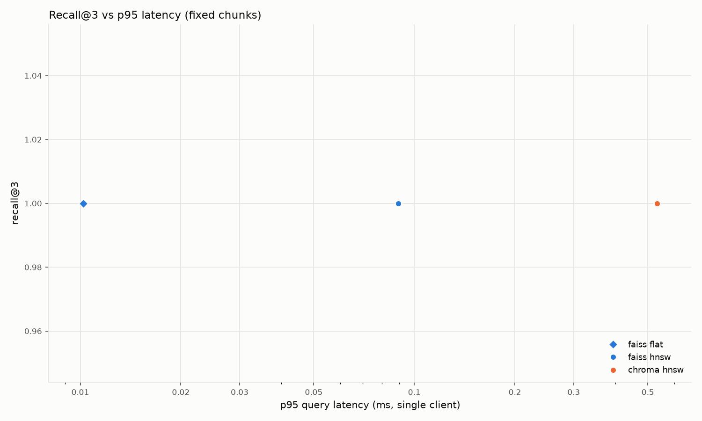
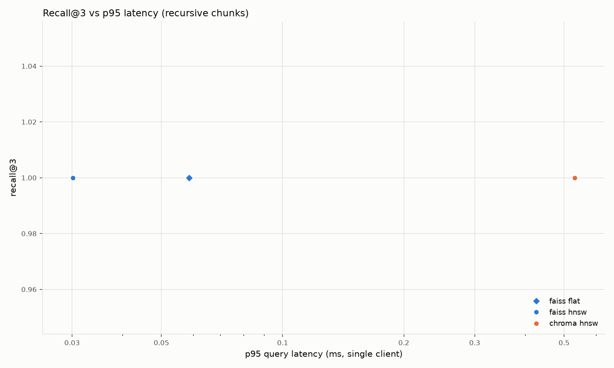

# rag-benchmark results

- Mode: `rag`
- Dataset: corpus: 10 docs, 51 fixed chunks; corpus: 10 docs, 60 recursive chunks
- Queries: 30, k = 3, metric: cosine
- CPU: 13th Gen Intel(R) Core(TM) i7-1355U (12 logical cores)
- RAM: 15.7 GB
- OS: Windows-11-10.0.26300-SP0, Python 3.13.14
- Started: 2026-10-19T15:42:51

| Chunker | Backend | Config | Build (s) | Recall@3 | p50 (ms) | p95 (ms) | p99 (ms) | QPS (1 client) | QPS (batch) | Hit@3 | MRR@3 |
|---|---|---|---:|---:|---:|---:|---:|---:|---:|---:|---:|
| fixed | faiss | flat | 0.00 | 1.0000 | 0.009 | 0.010 | 0.010 | 110,335 | 24,742 | 0.933 | 0.894 |
| fixed | faiss | hnsw M=16 efC=100 efS=32 | 0.00 | 1.0000 | 0.081 | 0.089 | 0.099 | 11,788 | 131,234 | 0.933 | 0.894 |
| fixed | chroma | M=16 efC=100 efS=32 | 0.06 | 1.0000 | 0.271 | 0.533 | 0.740 | 3,240 | 26,836 | 0.933 | 0.894 |
| recursive | faiss | flat | 0.00 | 1.0000 | 0.010 | 0.059 | 0.081 | 52,292 | 24,091 | 1.000 | 0.944 |
| recursive | faiss | hnsw M=16 efC=100 efS=32 | 0.00 | 1.0000 | 0.028 | 0.030 | 0.034 | 35,319 | 250,209 | 1.000 | 0.944 |
| recursive | chroma | M=16 efC=100 efS=32 | 0.01 | 1.0000 | 0.380 | 0.531 | 0.548 | 2,471 | 17,212 | 1.000 | 0.944 |

